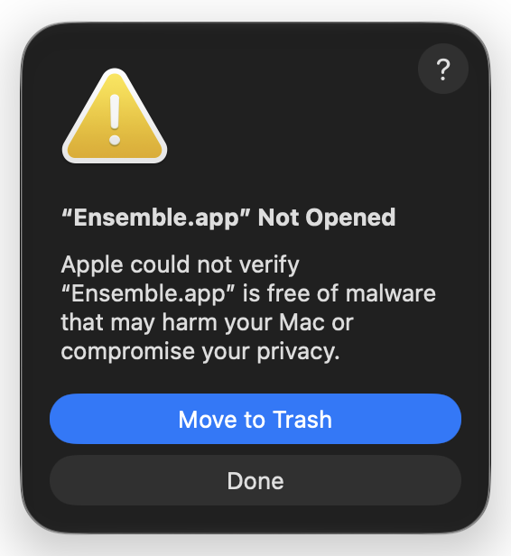
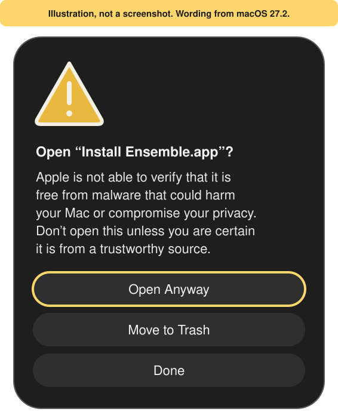
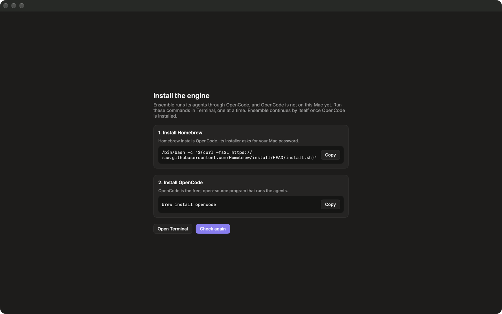

# Install Ensemble

This guide takes you from the download to a working app. It takes about ten minutes, most of it waiting for one install command.

Short version:

1. Download `Ensemble-<version>.dmg`, open it, drag Ensemble onto Applications.
2. Open Ensemble. macOS blocks it the first time. Go to System Settings, Privacy & Security, and press **Open Anyway**. [Why, and the exact steps](#first-launch-the-macos-warning).
3. Run `brew install opencode` in Terminal. Ensemble shows this command and carries on by itself.
4. In Ensemble, open Settings, Accounts, and sign in or add an API key.

## What you need

- A Mac with Apple silicon (M1 or newer). There is no Intel build.
- macOS 26 or later.
- [Homebrew](https://brew.sh), to install the engine. If you do not have it, Ensemble shows you the command.
- An account or API key for at least one model provider.

## 1. Download and check

Download two files from this project's Releases page: `Ensemble-<version>.dmg` and `SHA256SUMS`.

Only download Ensemble from the project's own page. A copy from anywhere else could have been changed.

Then check that your download is the file the project published. In Terminal:

```bash
cd ~/Downloads && shasum -a 256 -c SHA256SUMS
```

It must print `Ensemble-<version>.dmg: OK`. If it prints `FAILED`, delete the download and do not open it.

## 2. Install

Open the `.dmg` file. A window opens. Drag **Ensemble** onto **Applications**.


Then eject the disk image (drag it to the Trash, or press the eject button next to "Ensemble" in the Finder sidebar). `First launch.txt` holds a short copy of the next section, in case you are offline.

## First launch: the macOS warning

Open Ensemble from your Applications folder. The first time, macOS stops it:



This is expected, and every copy of Ensemble does it. **Press Done.** Do not press Move to Trash, which is the highlighted button.

### What the warning means

macOS has a guard called Gatekeeper. It checks every app that was downloaded from the internet before it runs for the first time. It looks for two things: a signature from a developer registered with Apple (a "Developer ID"), and proof that Apple scanned that exact copy for known malware (called "notarization").

Ensemble has neither. Both need a membership in the Apple Developer Program, which costs 99 US dollars a year. Ensemble is a free, open-source project and does not have one.

So the warning means **"Apple has not checked this app"**. It does not mean "Apple checked this app and found something". macOS shows the same message for every app that is not notarized.

That also means Apple's warning is doing its job: nobody has vouched for this file except the project. Before you go on, be sure of two things:

- You downloaded it from this project's own page.
- The SHA-256 check in step 1 printed `OK`.

If you would rather not trust a download at all, you can read the source and [build it yourself](../README.md#build). A copy you build on your own Mac has no warning.

This project cannot remove the warning without the paid membership. Nothing in this guide turns Gatekeeper off, and you should not turn it off for an app. The steps below make one exception, for Ensemble only.

### Open it anyway

These steps were checked on macOS 27.2. macOS 26 uses the same steps. Small differences in wording are possible. They are also in Apple's own guide: [Open a Mac app from an unknown developer](https://support.apple.com/guide/mac-help/open-a-mac-app-from-an-unknown-developer-mh40616/mac).

1. Try to open Ensemble once and press **Done** on the warning. (You have just done this. macOS only offers the next step after a blocked attempt.)
2. Open **System Settings** and choose **Privacy & Security** in the sidebar.
3. Scroll down to **Security**. You see a line saying Ensemble was blocked. Press **Open Anyway**.

   

   The button stays for about an hour after the blocked attempt. If it is not there, open Ensemble again, press Done, and come back.
4. macOS asks once more. Press **Open Anyway**.

   

5. Confirm with Touch ID or your Mac password.

Ensemble opens. macOS remembers the exception, so from now on it opens like any other app.

(On your Mac the dialogs may say "Ensemble" instead of "Ensemble.app". That depends on a Finder setting.)

### The same thing in Terminal

If you prefer one command to the five steps above:

```bash
xattr -dr com.apple.quarantine /Applications/Ensemble.app
```

When a browser downloads a file, macOS attaches a mark to it called `com.apple.quarantine`. That mark is what makes Gatekeeper check the app. This command removes the mark from Ensemble and from nothing else. It changes no setting on your Mac. Then open Ensemble as usual.

## 3. Set up the engine

Ensemble is the window. The agents are run by [OpenCode](https://opencode.ai), a free, open-source program that Ensemble starts and talks to in the background. OpenCode is not inside the download, so a new Mac shows this:



1. Press **Open Terminal**.
2. If the window lists **Install Homebrew**, press **Copy** next to it, paste the command into Terminal and press Return. It asks for your Mac password and takes a few minutes. If you already have Homebrew, this step is not shown.
3. Press **Copy** next to **Install OpenCode**, paste, press Return:

   ```bash
   brew install opencode
   ```

Ensemble looks for OpenCode every few seconds and continues by itself when the install finishes. **Check again** looks at once.

Ensemble never downloads or runs an installer on its own. You run both commands yourself.

Ensemble needs OpenCode 2.3.0 or newer. If yours is older, Ensemble says so and shows `brew upgrade opencode`.

## 4. Sign in to your models

Open **Settings** (bottom of the sidebar, or Command-comma) and choose **Accounts**.

- **Your subscriptions.** Each row has its own button or its own short instructions:
  - ChatGPT, SuperGrok, GitHub Copilot and others: press **Sign in** and finish in your browser.
  - Claude (Pro or Max): Ensemble uses Anthropic's own `claude` command line tool, signed in as you. The row shows how to install it and sign in.
  - Google AI (Pro or Ultra): Ensemble uses Google's own `agy` command line tool. The row shows how to install it.
- **API keys.** Paste a key for Anthropic, OpenAI, xAI, Google, OpenRouter or any other provider in the list.

You need one of these to start. Then press **New session**, pick a folder and a model, and send a message.


macOS may ask for a few permissions as you use the app: notifications (when an agent needs you), the microphone (only if you dictate a message), and your keychain (only if you pair an iPhone).

## Updating

There is no automatic update. To update:

1. Quit Ensemble.
2. Download the new `.dmg`, check it against its `SHA256SUMS`, and drag Ensemble onto Applications. Choose **Replace**.
3. Open it. macOS shows the warning again for every new download, so repeat [Open it anyway](#open-it-anyway).

Your sessions, settings and sign-ins stay. If you paired an iPhone, macOS asks for your password again before the new copy can read the pairing code from your keychain. That is because each build has a different signature.

To update the engine: `brew upgrade opencode`.

## Uninstalling

1. Quit Ensemble and drag it from Applications to the Trash.
2. To remove its data too:

   ```bash
   rm -rf ~/Library/Application\ Support/Ensemble
   ```

   ```bash
   defaults delete com.coquetteluke.ensemble
   ```

3. If you paired an iPhone, open **Keychain Access**, search for `com.coquetteluke.ensemble`, and delete what it finds.
4. Folders you worked in may hold a `.ensemble` folder (session worktrees). Delete it if you do not need those branches.

OpenCode is a separate program with its own data, and other tools may use it. To remove it as well: `brew uninstall opencode`.

## iPhone remote

The iPhone app is not part of this download. Without a paid Apple Developer account it cannot be shared as an app: you can only build it yourself with Xcode and install it on your own iPhone. See the [README](../README.md).

## Problems

- **No Open Anyway button.** It appears only after a blocked attempt and stays for about an hour. Open Ensemble again, press Done, then look again.
- **"Ensemble is damaged and can't be opened."** The download is incomplete or was changed. Delete it, download again, and run the SHA-256 check.
- **The window stays on "Install the engine".** In Terminal, run `which opencode`. If it prints nothing, the install did not finish: run `brew install opencode` again and read its output.
- **"The engine did not start."** Run `opencode service status` in Terminal and read what it says, then press Try again in Ensemble.
