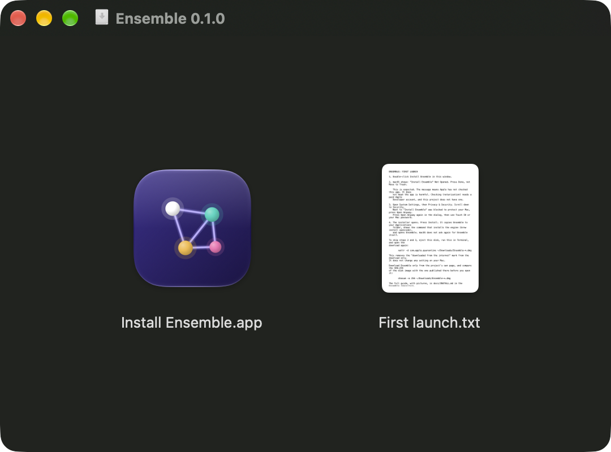
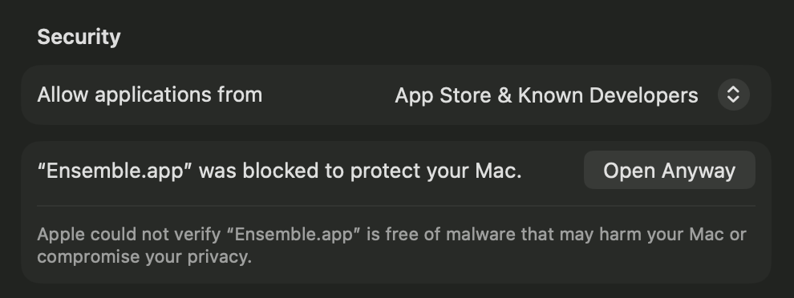
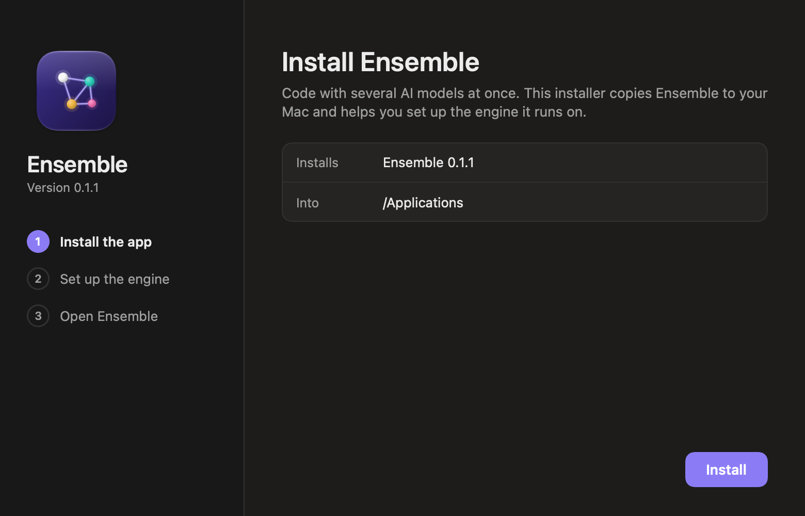
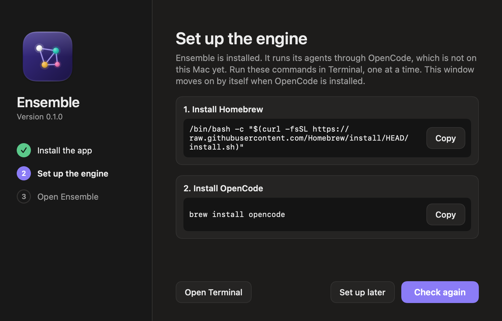
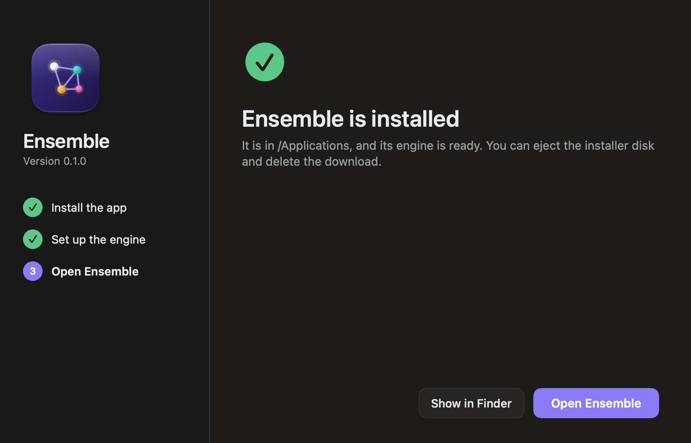
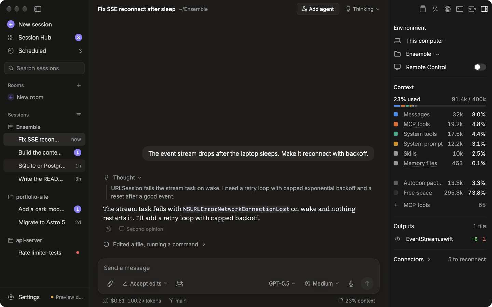

# Install Ensemble

This guide takes you from the download to a working app. It takes about ten minutes, most of it waiting for one install command.

Short version:

1. Download `Ensemble-<version>.dmg`, open it, and double-click **Install Ensemble**.
2. macOS blocks the installer the first time. Go to System Settings, Privacy & Security, and press **Open Anyway**. [Why, and the exact steps](#first-launch-the-macos-warning).
3. In the installer, press **Install**, then **Install the engine**. It copies Ensemble to Applications, downloads the engine for you, and opens Ensemble. You do not need Homebrew or anything else.
4. In Ensemble, open Settings, Accounts, and sign in or add an API key.

## What you need

- A Mac with Apple silicon (M1 or newer). There is no Intel build.
- macOS 26 or later.
- An internet connection during the install, for the engine (about 110 MB).
- An account or API key for at least one model provider.

## 1. Download and check

Download two files from this project's [Releases page](https://github.com/coquetteluke/ensemble/releases): `Ensemble-<version>.dmg` and `SHA256SUMS`. They are under "Assets" in the newest release.

Only download Ensemble from the project's own page. A copy from anywhere else could have been changed.

Then check that your download is the file the project published. In Terminal:

```bash
cd ~/Downloads && shasum -a 256 -c SHA256SUMS
```

It must print `Ensemble-<version>.dmg: OK`. If it prints `FAILED`, delete the download and do not open it.

## 2. Open the installer

Open the `.dmg` file. A window opens with **Install Ensemble** in it. Double-click it.



`First launch.txt` holds a short copy of the next section, in case you are offline.

## First launch: the macOS warning

The first time, macOS stops the installer:


This is expected, and every copy of Ensemble does it. **Press Done.** Do not press Move to Trash, which is the highlighted button.

### What the warning means

macOS has a guard called Gatekeeper. It checks every app that was downloaded from the internet before it runs for the first time. It looks for two things: a signature from a developer registered with Apple (a "Developer ID"), and proof that Apple scanned that exact copy for known malware (called "notarization").

Ensemble and its installer have neither. Both need a membership in the Apple Developer Program, which costs 99 US dollars a year. Ensemble is a free, open-source project and does not have one.

So the warning means **"Apple has not checked this app"**. It does not mean "Apple checked this app and found something". macOS shows the same message for every app that is not notarized.

That also means Apple's warning is doing its job: nobody has vouched for this file except the project. Before you go on, be sure of two things:

- You downloaded it from this project's own page.
- The SHA-256 check in step 1 printed `OK`.

If you would rather not trust a download at all, you can read the source and [build it yourself](../README.md#build). A copy you build on your own Mac has no warning.

This project cannot remove the warning without the paid membership. Nothing in this guide turns Gatekeeper off, and you should not turn it off for an app. The steps below make one exception, for this installer only.

### Open it anyway

These steps were checked on macOS 27.2. macOS 26 uses the same steps. Small differences in wording are possible. They are also in Apple's own guide: [Open a Mac app from an unknown developer](https://support.apple.com/guide/mac-help/open-a-mac-app-from-an-unknown-developer-mh40616/mac).

1. Open Install Ensemble once and press **Done** on the warning. (You have just done this. macOS only offers the next step after a blocked attempt.)
2. Open **System Settings** and choose **Privacy & Security** in the sidebar.
3. Scroll down to **Security**. You see a line saying Install Ensemble was blocked. Press **Open Anyway**.

   

   The button stays for about an hour after the blocked attempt. If it is not there, open Install Ensemble again, press Done, and come back.
4. macOS asks once more. Press **Open Anyway**.

   

5. Confirm with Touch ID or your Mac password.

The installer opens.

(On your Mac the dialogs may say "Install Ensemble" without ".app". That depends on a Finder setting.)

### The same thing in Terminal

If you prefer one command to the five steps above, eject the Ensemble disk if it is open, then run this before you open the download:

```bash
xattr -d com.apple.quarantine ~/Downloads/Ensemble-*.dmg
```

When a browser downloads a file, macOS attaches a mark to it called `com.apple.quarantine`. That mark is what makes Gatekeeper check what is inside. This command removes the mark from the Ensemble download and from nothing else. It changes no setting on your Mac. Then open the download and double-click Install Ensemble.

## 3. Install



Press **Install**. The installer:

1. Copies Ensemble into your Applications folder. If you may not change that folder, it uses the Applications folder in your home folder instead. An older Ensemble is replaced, and quit first if it is open.
2. Checks the copy's signature. If the check fails, nothing is installed.
3. Takes the "downloaded from the internet" mark off the copy it installed. That is why macOS does not ask a second time when Ensemble opens: you approved the installer, and it applies that to the one app it carries. It touches nothing else and changes no setting.

### The engine

Ensemble is the window. The agents are run by [OpenCode](https://opencode.ai), a free, open-source program that Ensemble starts and talks to in the background. OpenCode is not inside the download. If it is not on your Mac, the installer shows this next:



Press **Install the engine**. Nothing is downloaded before you press it. The installer then:

1. Downloads OpenCode's own Mac build from OpenCode's releases on GitHub.
2. Checks it twice: against the SHA-256 that OpenCode publishes, and that it is signed by OpenCode's Apple developer certificate. A file that fails either check is thrown away.
3. Puts it in `~/.opencode/bin`, the same folder OpenCode's own installer uses. No password is needed.

You do not need Homebrew. If you already use it, the window also shows `brew install opencode`, which works just as well. **Set up later** skips the engine: Ensemble offers the same button when you open it.

Ensemble needs OpenCode 2.3.0 or newer.

### Done



Press **Open Ensemble**. You can now eject the Ensemble disk and delete the download.

## Let your AI assistant install it

If you use an AI assistant that can run commands on your Mac (Claude Code, Codex, Gemini CLI and the like), you can hand it the whole job. Paste this:

```text
Install the Ensemble Mac app for me from https://github.com/coquetteluke/ensemble, using its terminal installer, not the graphical one.

1. Download https://raw.githubusercontent.com/coquetteluke/ensemble/main/scripts/install-ensemble.sh into a temporary folder and read it before you run it. It should only do this: download the newest Ensemble release, check it against the published SHA-256, copy Ensemble to my Applications folder, install the OpenCode engine into ~/.opencode/bin if it is missing, and open Ensemble.
2. Run it with: bash install-ensemble.sh
3. Do not use sudo, do not ask me for my password, and do not change any security setting. If the script asks for any of those, stop and tell me.
4. When it finishes, tell me the version it installed and the lines it printed. If a step failed, show me the exact error and do not try another way of installing it.
```

What that does, so you know what you are agreeing to:

- It runs [`scripts/install-ensemble.sh`](../scripts/install-ensemble.sh) from this repository. You can also run it yourself in Terminal.
- The script downloads the same disk image as above, checks its SHA-256, and runs the installer inside it without opening its window. The result is the same as pressing Install, Install the engine and Open Ensemble.
- There is no macOS warning on this path. Files fetched by a command line tool do not get the "downloaded from the internet" mark that a browser adds, so Gatekeeper is not involved. The SHA-256 check is what stands in for it, which is why the prompt tells the assistant to read the script first.

## 4. Sign in to your models

Open **Settings** (bottom of the sidebar, or Command-comma) and choose **Accounts**.

- **Your subscriptions.** Each row has its own button or its own short instructions:
  - ChatGPT, SuperGrok, GitHub Copilot and others: press **Sign in** and finish in your browser.
  - Claude (Pro or Max): Ensemble uses Anthropic's own `claude` command line tool, signed in as you. The row shows how to install it and sign in.
  - Google AI (Pro or Ultra): Ensemble uses Google's own `agy` command line tool. The row shows how to install it.
- **API keys.** Paste a key for Anthropic, OpenAI, xAI, Google, OpenRouter or any other provider in the list.

You need one of these to start. Then press **New session**, pick a folder and a model, and send a message.



macOS may ask for a few permissions as you use the app: notifications (when an agent needs you), the microphone (only if you dictate a message), and your keychain (only if you pair an iPhone).

## Updating

There is no automatic update. To update:

1. Download the new `.dmg` and check it against its `SHA256SUMS`.
2. Open it and run **Install Ensemble**. macOS shows the warning again for every new download, so repeat [Open it anyway](#open-it-anyway).
3. Press **Install and replace**. If Ensemble is open, the installer quits it first.

Your sessions, settings and sign-ins stay.

One thing does come back after every update: if Ensemble keeps something in your login keychain, macOS asks for your login password once for each item the first time the new version opens. Choose **Always Allow** (the blue Allow button only lasts until you quit). The items are the iPhone pairing code and the relay key if you use the iPhone remote, and an API key or alert token if you saved one in Settings. If you use none of those, you are never asked. This cannot be avoided without a certificate issued by Apple: for every other app, macOS ties that approval to the exact build.

To update the engine: `~/.opencode/bin/opencode upgrade`, or `brew upgrade opencode` if you installed it with Homebrew.

## Uninstalling

1. Quit Ensemble and drag it from Applications to the Trash.
2. To remove its data too:

   ```bash
   rm -rf ~/Library/Application\ Support/Ensemble
   ```

   ```bash
   defaults delete com.coquetteluke.ensemble
   ```

3. If you paired an iPhone, open **Keychain Access**, search for `com.coquetteluke.ensemble`, and delete what it finds.
4. Folders you worked in may hold a `.ensemble` folder (session worktrees). Delete it if you do not need those branches.

OpenCode is a separate program with its own data, and other tools may use it. To remove it as well: `~/.opencode/bin/opencode uninstall` (it keeps your session data), or `brew uninstall opencode` if you installed it with Homebrew.

## iPhone remote

The iPhone app is not part of this download. Without a paid Apple Developer account it cannot be shared as an app: you can only build it yourself with Xcode and install it on your own iPhone. See the [README](../README.md).

## Problems

- **No Open Anyway button.** It appears only after a blocked attempt and stays for about an hour. Open Install Ensemble again, press Done, then look again.
- **"Install Ensemble is damaged and can't be opened."** The download is incomplete or was changed. Delete it, download again, and run the SHA-256 check.
- **"The copy did not pass its check."** The installer found that its copy of Ensemble was changed or cut short, and installed nothing. Download it again.
- **"You do not have permission to change that folder."** Ask someone with an administrator account on this Mac to run the installer.
- **The engine download fails.** The installer says why. "Did not match the checksum" or "is not signed by OpenCode" means the file was changed or cut short on the way: press Try again. No connection: connect and press Try again, or press Set up later and use the Install the engine button in Ensemble.
- **Ensemble shows "Install the engine".** OpenCode is not installed yet. Press the button there. It does the same as the installer.
- **"The engine did not start."** Run `opencode service status` in Terminal and read what it says, then press Try again in Ensemble.
